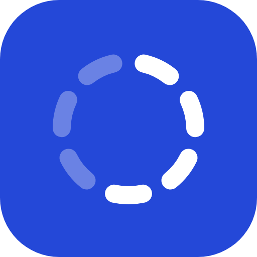
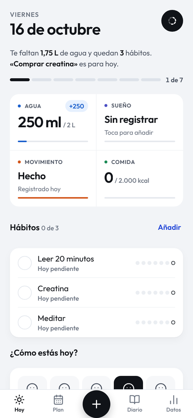
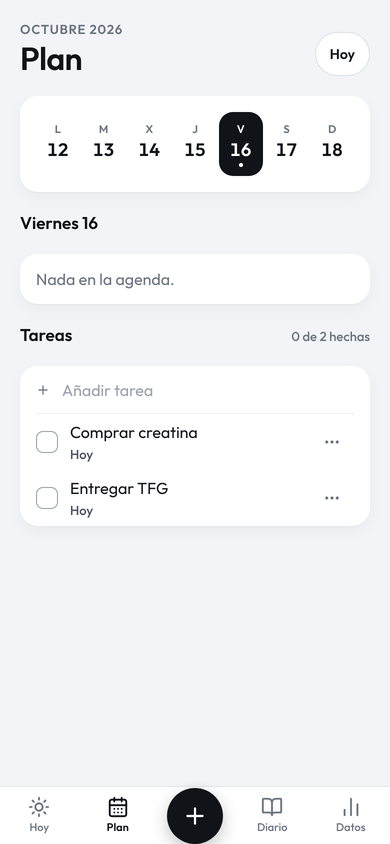
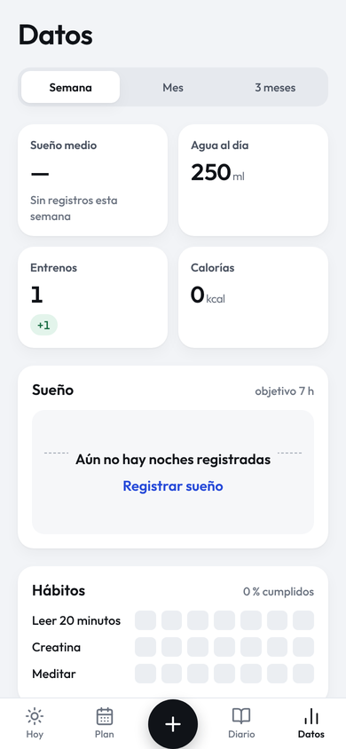
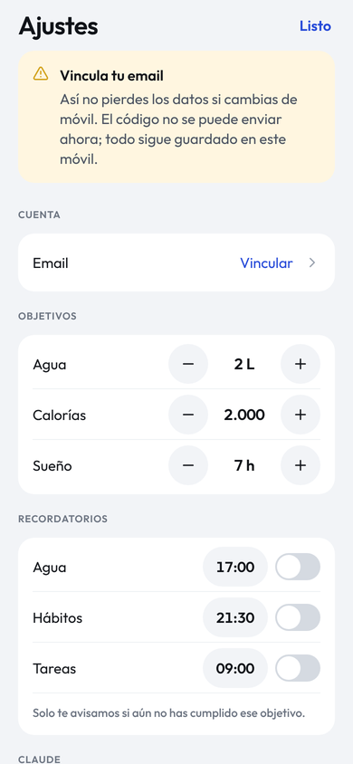

<p align="center">
  
</p>

<h1 align="center">Beacon</h1>

<p align="center">
  Salud, hábitos y tareas en una sola pantalla.<br>
  App Android personal, con Claude conectado por MCP para registrar y planificar hablando.
</p>

<p align="center">
  
  
  
  
</p>

## Qué hace

- **Hoy**: una frase con lo que te falta, la barra del día, agua, sueño, movimiento, comida, hábitos con racha, ánimo y tareas.
- **Plan**: calendario con vistas Mes, Semana (con horas), Día y Lista. Toca un hueco para crear un evento a esa hora; los eventos pueden tener hora de fin.
- **Entreno**: rutinas, sesión con series (Anterior, kg, reps, ✓), borrar series deslizando o manteniendo pulsado, temporizador de descanso, resumen al terminar, historial editable y progreso de fuerza por ejercicio.
- **Diario**: reflexiones y notas.
- **Datos**: medias de la semana, el mes o los 3 meses, gráfica de sueño, mapa de hábitos y peso.
- **Resumen semanal**: el domingo y el lunes, Hoy enseña cómo fue la semana frente a la anterior (sueño, entrenos, hábitos, agua y tu mejor racha). Opcionalmente, un aviso el domingo por la tarde.
- **Botón +**: agua en un toque y cualquier otro registro en dos.
- **Claude**: desde claude.ai puedes decir «apunta 500 ml y una ensalada», «anoche dormí de 0:30 a 7:45», «peso 74,2», «clase el jueves de 14:00 a 15:30» o «¿qué me queda hoy?» y Beacon se actualiza.
- **Sin conexión**: si no hay red, guarda en el móvil y sube los datos cuando vuelve la conexión.
- **Recordatorios** locales de agua, hábitos, tareas y resumen semanal.

## Tecnología

| Parte | Qué usa |
|---|---|
| App | Expo SDK 54, React Native 0.81, TypeScript, React Navigation 7, Reanimated 4, Gesture Handler, react-native-svg |
| Datos | Supabase (Postgres con RLS `user_id = auth.uid()`), sesión anónima |
| Claude | Servidor MCP remoto (Streamable HTTP) como Edge Function `lifepp-mcp`, con token propio por usuario |
| Builds | EAS Build (APK `preview`) y EAS Update (canal `preview`) |

## Estructura

```
App.tsx                  arranque, fuentes y proveedores
navigation/              pestañas (Hoy, Plan, +, Diario, Datos) y pila de modales
screens/                 pantallas; log/ y modals/ son formularios
components/ui/           sistema de componentes (Card, Button, Sheet, Toast, AnimatedNumber, BeaconMark…)
constants/               tokens de color, tipografía, espacio y movimiento
services/                acceso a datos por tabla, recordatorios y conector de Claude
lib/                     cliente de Supabase con respaldo local, almacenamiento y hápticos
utils/                   formato de números, frase del día, rachas
supabase/
  schema.sql             esquema inicial (solo para un proyecto vacío)
  seed/                  datos de demostración y su limpieza
  migrations/            RLS, conector MCP y registros (ya aplicadas)
  functions/lifepp-mcp/  servidor MCP para claude.ai
docs/
  DESIGN.md              sistema de diseño y especificación de pantallas
  DESIGN_REVIEW.md       última auditoría de diseño
  DEPLOY.md              cómo desplegar Supabase y conectar Claude
  design/                mockups HTML de referencia
  brand/, screenshots/   logo y capturas
```

## Desarrollo

```bash
npm ci
npx expo start            # Expo Go o navegador
npm run typecheck         # comprobación de tipos
npm test                  # tests
```

El proyecto de Supabase (URL y clave publishable, ambas públicas) está en `constants/supabase.ts`.
Sin conexión, la app funciona igual con almacenamiento local.

**Datos de demostración:** `supabase/seed/demo.sql` crea unas 6 semanas de datos realistas (agua, sueño, comidas, entrenos con series, hábitos, peso, diario, tareas y eventos) en la cuenta con el conector activo. Se ejecuta en el SQL Editor de Supabase y se borra con `supabase/seed/demo-clean.sql`; los ids de la demo empiezan por `dec0de00-`, así que tus datos reales no se tocan.

## Publicar en el móvil

```bash
# APK nuevo (cuando cambian dependencias nativas, el icono o la versión)
npx eas-cli build -p android --profile preview

# Solo JavaScript (textos, pantallas, lógica) sobre el APK instalado de la misma versión
npx eas-cli update --channel preview -m "Descripción del cambio"
```

El APK se instala **encima** del anterior, sin desinstalar, para conservar la sesión y los datos.

## Conectar Claude

1. En Beacon: **Ajustes → Claude → Crear enlace**.
2. En claude.ai: **Ajustes → Conectores → Añadir conector personalizado**, pegar el enlace y elegir «Sin inicio de sesión».
3. En un chat, activar el conector y pedir, por ejemplo: «Mira mi día en Beacon».

Herramientas disponibles (19):

- **Leer:** `get_today`, `get_week`, `list_tasks`, `list_recent` (comidas, entrenos, sueño, peso, eventos, diario o notas de los últimos días, con sus ids).
- **Registrar:** `log_water`, `log_habit`, `log_meal`, `log_workout`, `log_mood`, `log_sleep`, `log_weight`.
- **Agenda y escritura:** `add_tasks`, `update_task`, `add_event`, `update_event`, `add_journal`, `add_note`.
- **Borrar:** `delete_entry`, solo cuando se pide expresamente.

Más detalle en [docs/DEPLOY.md](docs/DEPLOY.md).

## Nombres internos

La app se llamó Capalot y después Lifepp. Algunos identificadores internos siguen siendo `lifepp` a propósito, porque cambiarlos rompería cosas que ya funcionan:

- el paquete Android `com.pceba.lifepp`: si cambia, el APK se instala como una app nueva y se pierde la sesión;
- el slug y el proyecto de Expo: las builds y los updates van ligados a ellos;
- las claves de almacenamiento `lifepp_*`: ahí están los datos locales;
- la Edge Function `lifepp-mcp`: su URL está dentro del enlace del conector.
